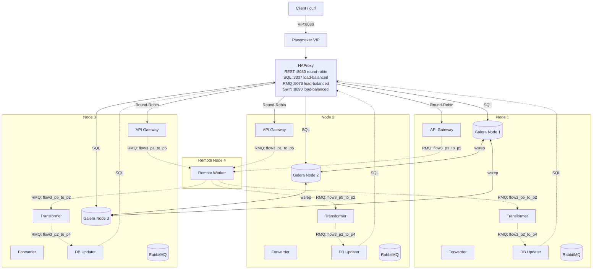
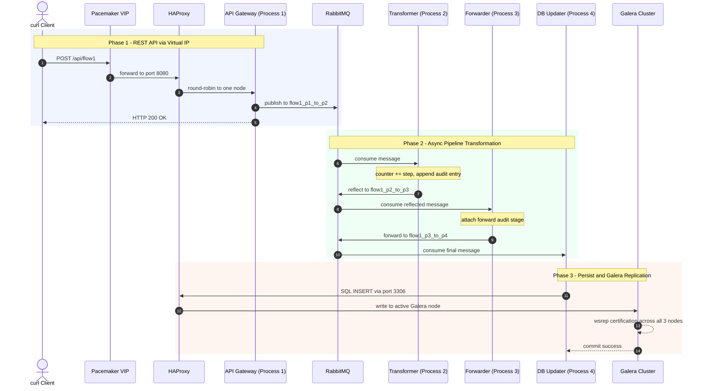
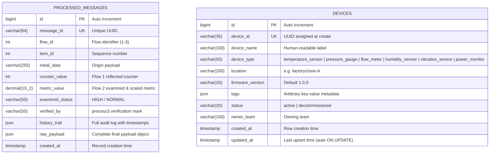
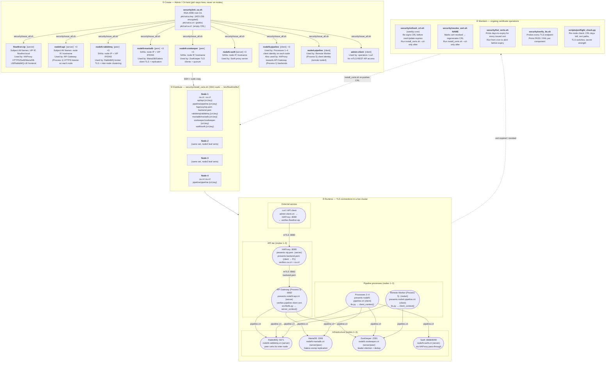
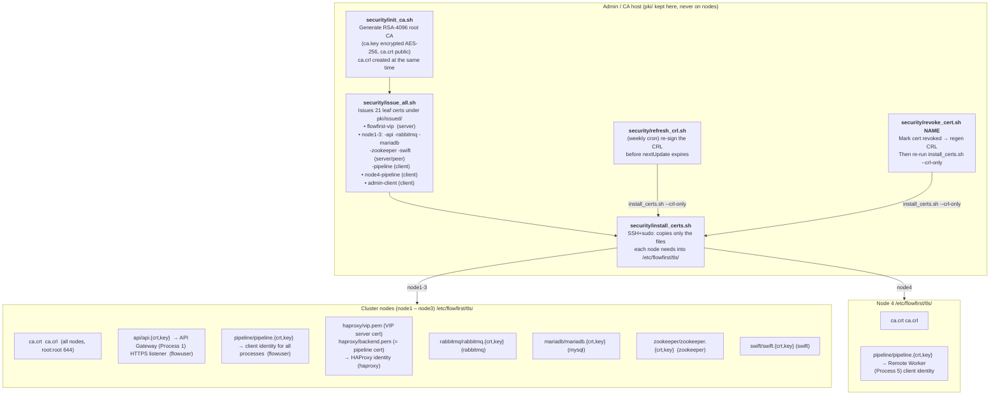
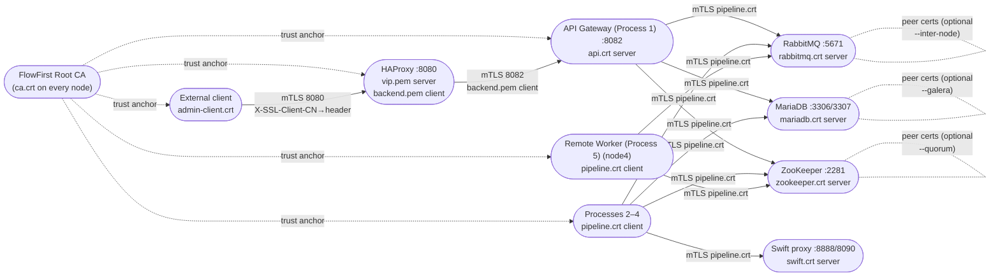
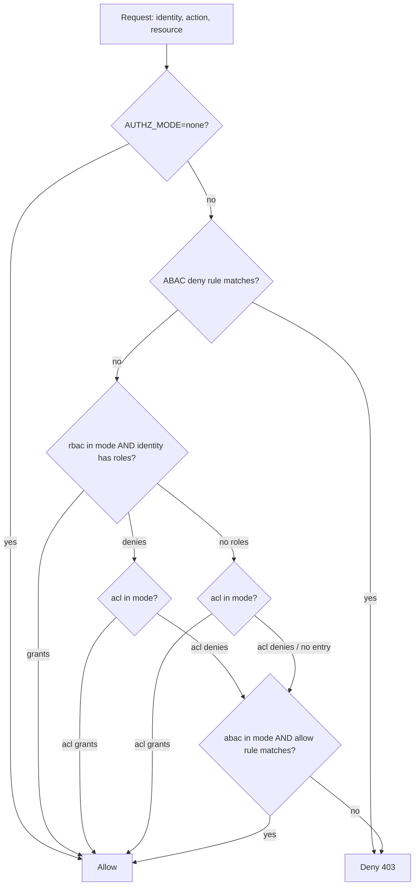

# FlowFirst — Architecture Diagrams

All Mermaid diagrams for the FlowFirst solution in one place.
Links back to the relevant section of [ReadMe.md](../ReadMe.md) are provided under each diagram title.

---

## 1. Multi-Node Cluster Architecture & Network Topology

> Source: [ReadMe.md § Multi-Node Cluster Architecture](../ReadMe.md#multi-node-cluster-architecture--network-topology)

Shows the 4-node cluster layout: Nodes 1–3 running all pipeline processes, Galera, RabbitMQ, ZooKeeper and HAProxy; Remote Node 4 running the Remote Worker only; the Pacemaker Virtual IP as the single entry point; and HAProxy round-robin to API Gateway instances.

---

## 2. End-to-End Sequence & Galera Replication Flow

> Source: [ReadMe.md § End-to-End Sequence](../ReadMe.md#end-to-end-sequence--galera-replication-flow)

Shows a single Flow 1 request travelling from the client through HAProxy → API Gateway → RabbitMQ → Transformer → Forwarder → DB Updater → Galera wsrep replication.

---

## 3. Database Schema & ER Diagram

> Source: [ReadMe.md § Database Schema](../ReadMe.md#database-schema--er-diagram)

Entity-relationship diagram for the two MariaDB tables: `processed_messages` (Flows 1–3) and `devices` (Flows 4–7 IoT CRUD).

---

## 4. SSL Certificate Creation, Distribution and Runtime Usage

> Source: [ReadMe.md § Certificate lifecycle and runtime usage](../ReadMe.md#certificate-lifecycle-and-runtime-usage)

Four-stage view of the full TLS certificate lifecycle:
- **① Create** — `security/init_ca.sh` + `issue_all.sh` produce 21 certificates (server, peer and client profiles) on the admin/CA host
- **② Distribute** — `security/install_certs.sh` pushes only the needed files to each node via SSH+sudo
- **③ Runtime** — which certificate each component presents and verifies in a live cluster
- **④ Maintain** — CRL refresh, revocation, expiry checks and per-node preflight

---

## 5. PKI Lifecycle — Creation, Distribution and Renewal

> Source: [ReadMe.md § PKI lifecycle](../ReadMe.md#certificate-lifecycle-and-runtime-usage)

Left-to-right view focused on the admin host: CA initialisation, 21 leaf certificate issuance, per-node distribution, weekly CRL refresh and certificate revocation.

---

## 6. Runtime TLS Connections — Who Presents Which Certificate

> Source: [ReadMe.md § Runtime TLS connections](../ReadMe.md#certificate-lifecycle-and-runtime-usage)

Left-to-right map of every live TLS connection: external client mTLS through HAProxy, re-encrypted backend to API Gateway (Process 1), and all pipeline processes presenting their `pipeline.crt` client identity to RabbitMQ, MariaDB, ZooKeeper and Swift.

---

## 7. Authorization Decision Flowchart (RBAC / ACL / ABAC)

> Source: [ReadMe.md § Authorization](../ReadMe.md#scenario-65-authorization-rbac-acl-and-abac)

Hardwired evaluation order for `AUTHZ_MODE`: ABAC deny → RBAC → ACL → ABAC allow → default DENY. Shows how `rbac+acl+abac` combines all three engines.

---

*Generated from [`ReadMe.md`](../ReadMe.md). Re-extract with `grep -n '^\`\`\`mermaid' ReadMe.md` to find updated line numbers.*
